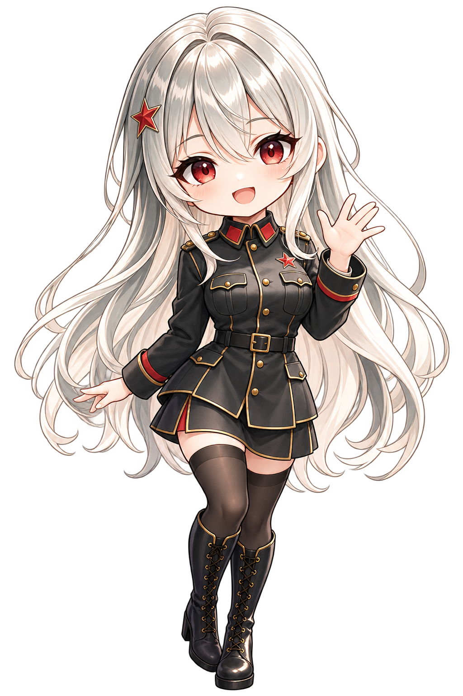

<div align="center">

# Long March Style

**A DeepSeek Harness theme inspired by The Fire Rises' Long March girl.**

[](README.en.md) [](README.md)

[](LICENSE)

</div>

## Preview

The interface takes the Long March girl's command terminal as its cue: a deep violet canvas, an accent aurora and a faint grid behind the home page, a gradient greeting and a composer card that lights up when it holds focus. Switch between the crimson and cyan palettes in the plugin settings; light and dark follow the system.

New conversations show a Chinese greeting that addresses the user as 同志 (comrade). When the account-hold easter egg is enabled, the account menu opens a simulated access-hold drill; closing it returns to the current task.

### The corner mascot

A mascot stands in the window's bottom-right corner, with a bubble over its head saying what the agent is doing; drag it anywhere and it keeps its place. It can follow the theme (crimson → Long March, cyan → Big Fish), or be chosen on its own.

**Big Fish** is the blue-haired whale-tail maid, acting out the task's state:

<table>
  <tr>
    <td align="center" width="25%"><br />Idle</td>
    <td align="center" width="25%"><br />Thinking</td>
    <td align="center" width="25%"><br />Answering and calling tools</td>
    <td align="center" width="25%"><br />Several sessions / subagents</td>
  </tr>
  <tr>
    <td align="center" width="25%"><br />Waiting on you</td>
    <td align="center" width="25%"><br />Compacting context</td>
    <td align="center" width="25%"><br />Failed</td>
    <td align="center" width="25%"><br />Finished</td>
  </tr>
  <tr>
    <td align="center" width="25%"><br />Drowsy</td>
    <td align="center" width="25%"><br />Poked</td>
    <td align="center" width="25%"><br />Tickled</td>
    <td align="center" width="25%"><br />Dragged</td>
  </tr>
</table>

**Long March** uses an included animation created from the reference image. She blinks and waves at rest and changes expression while working, waiting, celebrating, encountering an error or responding to interaction, with breathing, swaying and hopping motions. In Settings › Appearance › Mascot you can upload a picture you may use (PNG, WebP, GIF, SVG or JPG, up to 8 MB; a transparent background works best), or place it at `$DSH_HOME/dsh-claude-style/brand/mascot.png`. Removing a custom picture restores the included animation.



## Installation

Install the development dependencies, build the project, and add its directory to a DSH profile:

```bash
npm install
npm run build
dsh plugin --profile desktop add "<project-directory>"  # desktop app
dsh plugin --profile web add "<project-directory>"      # web app
```

Choose the profiles you use. Restart DeepSeek Harness and open Long March Style on the plugin page. A local link requires the project directory to remain in place.

## Fonts

Inter and JetBrains Mono ship with the plugin. Headings prefer condensed technical fonts installed on the system. To replace a bundled face, put a file with the same name in `$DSH_HOME/dsh-claude-style/fonts/`.

## Documentation

| Document | Contents |
| --- | --- |
| [Design tokens](docs/STYLE.md) | The palette, typography, shape, motion and layer rules |
| [Architecture decisions](docs/adr/README.md) | One page per direction: background, decision, consequences, revisiting conditions |
| [Changelog](docs/CHANGELOG.md) | Version history |
| [Contributing](CONTRIBUTING.md) | Building from `packages/client/src/`, commit conventions, and the screenshot and regression tooling |

## License

Except where otherwise stated, this repository is licensed under MIT.

The Sodium rendering engine is licensed under the [PolyForm Shield License 1.0.0](packages/client/src/features/sodium/LICENSE).

## Acknowledgements

- "Sodium" (钠) is named after Minecraft's [Sodium](https://github.com/CaffeineMC/sodium) rendering mod; this plugin is not affiliated with it.
- The message navigator follows SherUnlocked-4869's [dsh-plugin-msg-nav](https://github.com/SherUnlocked-4869/dsh-plugin-msg-nav) (MIT).
- Big Fish's animations come from PC2005-cloud's [dsh-pet](https://github.com/PC2005-cloud/dsh-pet) (MIT), as re-encoded into frame sequences by QCYTSN's [dsh-dafeiyu](https://github.com/QCYTSN/dsh-dafeiyu); this is an unofficial fan-made plugin, not affiliated with DeepSeek.
- The enhanced animations in the chat area are modified from [dsh-chat-ux](https://github.com/alm-allen/dsh-chat-ux) (MIT).

## Related projects

> Running several themes at once? Try [dsh-skin-manager](https://github.com/xiaoyangcheng84-svg/dsh-skin-manager) — it switches between all installed themes from a single settings page.

> Want to import your Claude Code / Codex session history into DSH and keep the conversation going? Try the author's other plugin, [dsh-chat-import](https://github.com/Nwflower/dsh-chat-import).
